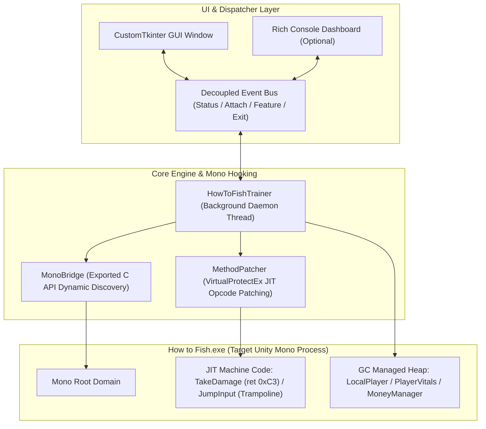

# How to Fish (渔力全开) - Modern Memory Trainer

[English](README.md) | [简体中文](README_zh.md)

A modern, high-performance external memory trainer for the Unity Mono action-survival game **[How to Fish (渔力全开)](https://store.steampowered.com/)**.

Powered by `pymem`, dynamic Mono runtime C API reflection, and JIT-level opcode patching. Features a **sleek CustomTkinter dark-mode Graphical User Interface (GUI)** alongside a **Rich interactive Terminal Dashboard (CLI)**, with bidirectional hotkey state synchronization, dynamic bilingual localization, and standalone single-file `.exe` packaging.

---

## 🌟 Key Features & Highlights

- 🎨 **Modern Dark Card-Style GUI**: Crafted with CustomTkinter, featuring pill-shaped animated toggle switches (`CTkSwitch`), multi-mode segmented buttons (`CTkSegmentedButton`), and pulsing connection indicators.
- ⚡ **Bidirectional Hotkey Synchronization**: Pressing hotkeys (`F1~F6`) in-game smoothly animates and flips the switches on the GUI in real time; toggling UI switches applies memory patches instantly.
- 🛡️ **Safety Guard & Auto-Revert**: Actions when the game is not running are intercepted with friendly prompts and automatic switch bounce-back; closing or crashing the game automatically resets all UI switches to OFF.
- 🔄 **Dual-Mode Execution**: Launches as a clean, windowed desktop app with zero background black cmd consoles by default; supports `--console` to fallback to the classic Rich terminal dashboard.
- 🌍 **Instant Bilingual Localization**: Seamlessly switch between **Chinese (中文)** and **English (EN)** at any time via `F12` or the header toggle button.
- 📦 **Compact Standalone Packaging**: Optimized PyInstaller bundling packages Python 3.14 + all themes into a single **~13.0 MB** executable without requiring Python to be installed.

---

## 🎮 Cheat Features & Hotkeys

| Hotkey | Feature | UI Control | Description |
| :---: | :---: | :---: | :--- |
| **F1** | **Lock Health / God Mode** | `CTkSwitch` | Intercepts damage functions (NPC hits, punches, hazards, fire, poison, starvation) and clears elemental gauges. **Normal jump physics and knockback are preserved.** |
| **F2** | **Lock Hunger** | `CTkSwitch` | Freezes fullness meter, preventing hunger depletion over time or during intensive actions. |
| **F3** | **Infinite Air Jump** | `CTkSwitch` | Pure movement JIT trampoline patch: bypasses ground detection and enables unlimited mid-air multi-jumps (**health logic unaffected; InGodMode is NOT used**). |
| **F4** | **Unlimited Ammo** | `CTkSwitch` | Hooks weapon ammo decrement, locks magazine capacity, and eliminates forced reload interruptions. |
| **F5** | **Damage Multiplier** | `CTkSegmentedButton` | Cycles damage multiplier for firearms, melee weapons, and fists: **`1x (Normal)` $\rightarrow$ `2x` $\rightarrow$ `5x` $\rightarrow$ `10x` $\rightarrow$ `One-Shot Kill (99999)`**. |
| **F6** | **Add Money (+1w)** | Amount Entry + Button | Adds **+$10,000 (1w)** money with sound FX, floating UI animation, and multiplayer synchronization on keypress or click. |
| **F12** | **Switch Language** | Segment Button / Hotkey | Toggles trainer interface language between **Chinese (中文)** and **English (EN)**. |
| **F10** | **Safe Exit** | Window Close / Hotkey | Restores all original machine code bytes and memory baselines, cleanly shutting down the trainer. |

---

## 🔬 Architecture & How It Works

Rather than relying on brittle pattern scans or memory searches, the trainer directly interfaces with the game's internal **`mono-2.0-bdwgc.dll` (Mono Virtual Machine)**:



1. **JIT Function Hooking (Logic Interception)**:
   - Invokes `mono_compile_method` to force early compilation of target C# methods into native x86_64 machine code.
   - Adjusts memory page protection using Windows `VirtualProtectEx`.
   - **God Mode**: Writes `0xC3` (`ret`) into the first byte of `TakeDamage`, neutralizing damage before execution begins.
   - **Infinite Jump**: Patches a direct assembly trampoline into `JumpInput`, calling native `Jump` directly without ground checks.
2. **Managed Heap Object Dynamic Traversal (Value Scaling)**:
   - Resolves the static `Player.LocalPlayer` pointer to locate the active player instance on the Mono GC heap.
   - **Damage Multiplier**: Caches unmodified base damage and scales in-memory values across weapons, melee upgrades, and bullet mods.
   - **Add Money**: Locates `MoneyManager.Instance`, increments the authoritative money field, and triggers native sync animations.
3. **Safe Teardown & Clean Restoration**:
   - Every patch records original unmodified bytes (`original_bytes`), restoring game memory completely upon disabling features or exiting.

---

## 🚀 Getting Started

### 1. Launch the Trainer

This project uses **`uv`** for dependency synchronization and virtual environment isolation. You can launch the trainer before or after starting the game:

```powershell
# 1. Launch in Modern GUI mode (default)
uv run python run_trainer.py

# 2. Launch in Classic Rich Terminal Dashboard mode
uv run python run_trainer.py --console

# 3. Launch with specific initial language (zh / en)
uv run python run_trainer.py --lang en
```

### 2. Build Standalone `.exe` Executable

Package the trainer into a single, dependency-free Windows `.exe`:

```powershell
# Build native windowed executable (outputs to dist/HowToFishTrainer.exe)
uv run python build.py

# Build with visible console window
uv run python build.py --console
```
The resulting `dist/HowToFishTrainer.exe` is only **~13.0 MB** and runs immediately without installing Python.

### 3. Run Automated Tests

A comprehensive suite covering cheats, engine decoupling, bidirectional events, and GUI components:

```powershell
uv run pytest -v
```
*(45 / 45 tests passing)*

---

## 📁 Repository Structure

```
how-to-fish-trainer-ui/
├── src/
│   └── howtofish_cheat/
│       ├── features/            # Cheat feature modules (Health, Hunger, Jump, Ammo, Damage, Money)
│       ├── mono/                # Mono runtime reflection & JIT method patcher
│       ├── ui/
│       │   ├── gui.py           # CustomTkinter modern GUI & feature cards
│       │   └── console.py       # Rich interactive terminal dashboard
│       ├── i18n.py              # Bilingual dictionary translations
│       ├── trainer.py           # Orchestrator engine (thread loop & decoupled event hooks)
│       └── __main__.py          # Entrypoint with CLI/GUI dual-mode dispatcher
├── tests/                       # Unit test suite (45 test cases)
├── build.py                     # Optimized PyInstaller build script
├── HowToFishTrainer.spec        # PyInstaller specification file
├── pyproject.toml               # Project configuration & uv dependencies
└── run_trainer.py               # Root quick-launch script
```

---

## ⚖️ Disclaimer

This project is for educational, reverse engineering research, and single-player entertainment purposes only. Do not use this tool in competitive public multiplayer matches or to grief other players.
