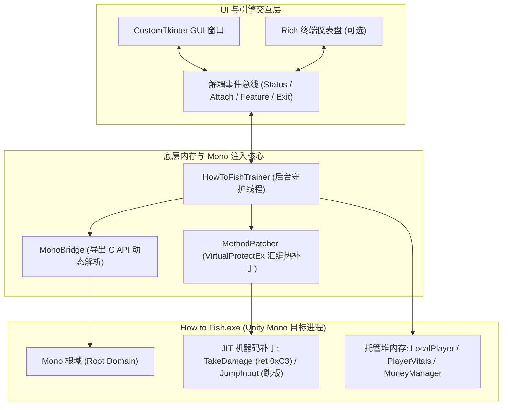

# 渔力全开 (How to Fish) - 现代化内存修改器与辅助工具

[English](README.md) | [简体中文](README_zh.md)

专为 Unity Mono 引擎动作生存游戏 **[渔力全开 (How to Fish)](https://store.steampowered.com/)** 打造的高颜值、轻量级外部内存修改器。

基于 `pymem` 与底层 Mono Runtime C API 动态解析实现 JIT 汇编级函数拦截与对象属性缩放。全新升级 **CustomTkinter 现代暗黑卡片式图形界面（GUI）**，并保留 **Rich 交互式终端仪表盘（CLI）** 双模支持，具备热键双向联动同步、多语言热切换与免 Python 依赖单文件 `.exe` 发行能力。

---

## 🌟 核心特性与亮点

- 🎨 **现代暗黑电竞风 GUI**：基于 CustomTkinter 构建，扁平圆角卡片布局，配备流畅的胶囊滑动开关（`CTkSwitch`）、多档位分段按钮（`CTkSegmentedButton`）与动态呼吸状态灯。
- ⚡ **全局热键双向无感联动**：全屏游戏中按下全局快捷键（`F1~F6`），修改器界面的开关与档位自动同步滑动切换；鼠标点击界面控件亦能瞬间生效。
- 🛡️ **未连接保护与自动复位**：游戏未运行时操作自动提示并回弹开关；游戏意外关闭或崩溃时，界面所有开关自动复位关闭，杜绝脏状态残留。
- 🔄 **双模启动自由切换**：默认以无黑框原生桌面窗口运行；加上 `--console` 参数可立即无缝切换至经典的 Rich 终端字符控制看板。
- 🌍 **中英文一键无缝热切换**：随时按下 `F12` 或点击右上角语言切换按钮，全界面与操作反馈实时更新。
- 📦 **极简独立单文件打包**：经深度精简与资源打包优化，PyInstaller 单文件构建产物仅 **~13.0 MB**，开箱即用，秒速启动。

---

## 🎮 作弊功能与热键一览

| 快捷键 | 功能名称 | UI 控件形式 | 详细功能说明 |
| :---: | :---: | :---: | :--- |
| **F1** | **锁定生命 / 无敌** | `CTkSwitch` 开关 | 拦截所有扣血函数（NPC攻击、拳头、陷阱、火焰、中毒、饥饿），消除负面属性槽。**完全保留正常跳跃与物理受击反馈。** |
| **F2** | **锁定饱食度** | `CTkSwitch` 开关 | 阻止饱食度随时间自然流逝或因行为动作消耗，永久维持满腹状态。 |
| **F3** | **无限空中多段跳** | `CTkSwitch` 开关 | 纯跳跃逻辑 JIT 跳板补丁：绕过触地检测，允许在空中无限次连跳与凌空飞行（**不影响血量逻辑，不开启 InGodMode**）。 |
| **F4** | **无限弹药 / 免换弹** | `CTkSwitch` 开关 | 拦截枪械弹药扣减逻辑，锁定弹匣容量，射击无需换弹，消除卡壳打断。 |
| **F5** | **伤害倍率调节** | `CTkSegmentedButton` 分段条 | 循环切换枪械、近战武器与徒手拳头伤害：**`1x 默认` $\rightarrow$ `2x` $\rightarrow$ `5x` $\rightarrow$ `10x` $\rightarrow$ `秒杀 (99999)`**。 |
| **F6** | **增加金币 (+1w)** | 动态输入框 + 增加按钮 | 默认增加 **+$10,000 (1万)** 金币，支持自定义金额。触发拾取音效、飘字动画与 HUD 滚动效果，并同步至多人联机网络。 |
| **F12** | **切换语言** | 分段按钮 / 热键 | 随时切换全界面与提示文本语言：**中文 (ZH)** / **English (EN)**。 |
| **F10** | **安全退出** | 窗口右上角 / 热键 | 一键还原所有被修改的机器码指令与数值基准，安全关闭修改器窗口。 |

---

## 🔬 底层架构与修改原理

修改器无需暴力搜索特征码，通过直接与游戏内置的 **`mono-2.0-bdwgc.dll` (Mono 虚拟机)** 交互完成高精度读写：



1. **JIT 函数汇编拦截（改逻辑）**：
   - 调用 `mono_compile_method` 强制将目标 C# 函数提前编译为 x64 原生机器码。
   - 使用 `VirtualProtectEx` 赋予内存页写权限。
   - **免伤无敌**：在 `TakeDamage` 第一字节写入 `0xC3`（`ret`），进函数即刻返回，伤害被物理吞噬。
   - **空中无限跳**：在 `JumpInput` 头部植入汇编跳转蹦床（Trampoline），强行跳过地面检测直接调用原生起跳。
2. **托管堆对象偏移读写（改数值）**：
   - 沿 `Player.LocalPlayer` 静态根指针计算偏移，动态定位本地角色各属性组件。
   - **伤害倍率**：缓存原始基础伤害，按倍数覆写 `_damage`，切换武器或关闭时无损复原。
   - **增加金币**：动态寻址单例 `MoneyManager.Instance`，修改金币字段并触发原生同步与飘字。
3. **安全还原机制**：
   - 记录所有修改前原始机器码（`original_bytes`），退出或关闭功能时 100% 还原，防止游戏崩溃。

---

## 🚀 使用指南

### 1. 运行修改器

本项目使用现代 Python 包管理器 **`uv`** 进行依赖管理与环境隔离。启动游戏前后均可运行修改器：

```powershell
# 1. 以现代 GUI 模式启动 (默认推荐)
uv run python run_trainer.py

# 2. 以经典 Rich 终端仪表盘模式启动
uv run python run_trainer.py --console

# 3. 指定初始语言启动 (zh / en)
uv run python run_trainer.py --lang en
```

### 2. 构建独立单文件 `.exe` 可执行程序

无需在目标电脑安装 Python 环境，直接打包为单一可执行程序：

```powershell
# 编译生成原生窗口化可执行程序 (生成于 dist/HowToFishTrainer.exe)
uv run python build.py

# 编译为带终端窗口的 exe 程序
uv run python build.py --console
```
打包后生成的 `dist/HowToFishTrainer.exe` 体积仅约 **13.0 MB**，双击即可直接运行。

### 3. 运行自动化测试

项目内置了针对底层作弊、引擎解耦、双向事件和 UI 组件的完整测试套件：

```powershell
uv run pytest -v
```
*(45 项自动化单元测试全部通过)*

---

## 📁 目录结构

```
how-to-fish-trainer-ui/
├── src/
│   └── howtofish_cheat/
│       ├── features/            # 核心作弊功能实现 (生命/饱食度/跳跃/弹药/伤害/金钱)
│       ├── mono/                # Mono 虚拟机动态解析桥接与 JIT 汇编补丁器
│       ├── ui/
│       │   ├── gui.py           # CustomTkinter 现代图形界面与卡片组件
│       │   └── console.py       # Rich 终端交互式控制台仪表盘
│       ├── i18n.py              # 中英双语本地化字典
│       ├── trainer.py           # 修改器引擎核心 (事件解耦、线程与进程轮询)
│       └── __main__.py          # 模块入口与双模启动参数分发
├── tests/                       # 单元测试套件 (45 个测试用例)
├── docs/                        # 深度逆向与技术架构白皮书
├── build.py                     # PyInstaller 优化打包脚本
├── HowToFishTrainer.spec        # PyInstaller 规约构建文件
├── pyproject.toml               # 项目配置与依赖管理 (uv)
└── run_trainer.py               # 快速启动入口脚本
```

---

## 📖 扩展技术文档

想了解更多关于游戏内存布局分析、FishNet 联机同步模型、Mono TLS 上下文以及 JIT 蹦床构造细节，请参阅：

👉 **[技术深度剖析与架构文档 (Technical Deep Dive)](docs/TECHNICAL_DEEP_DIVE.md)**

---

## ⚖️ 免责声明

本工具仅供技术研究、逆向工程学习及单人娱乐使用。请勿在任何公开对战或破坏他人游戏体验的联机环境中使用。
